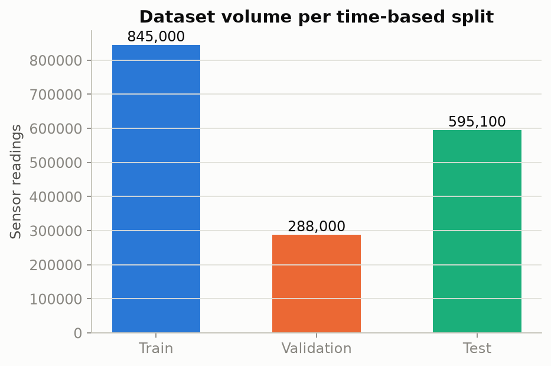
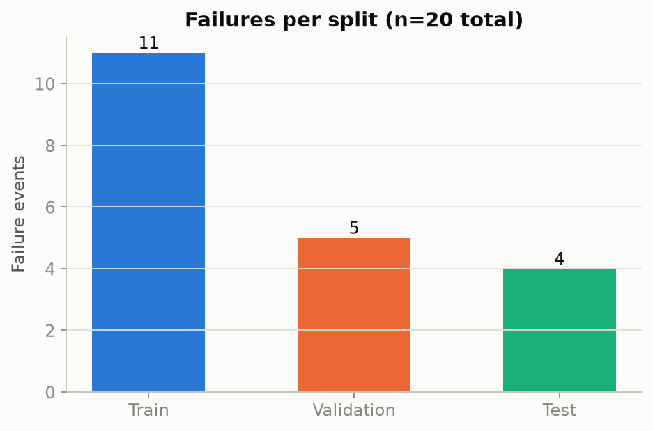
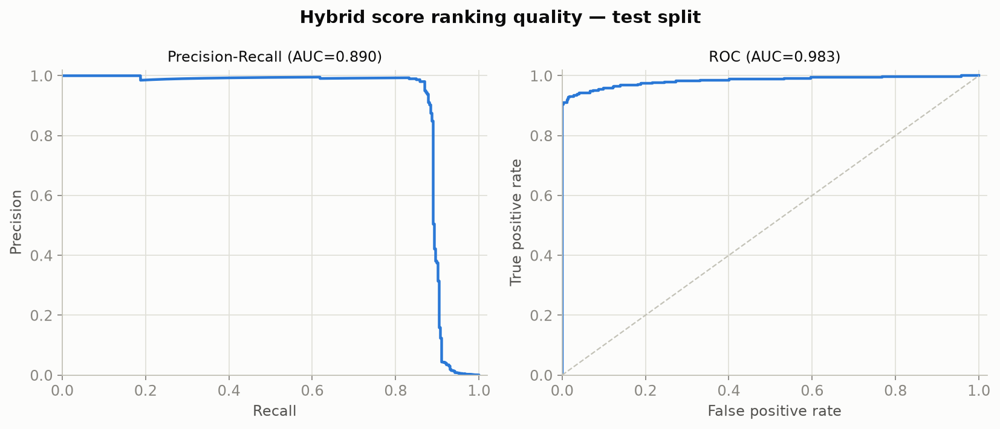
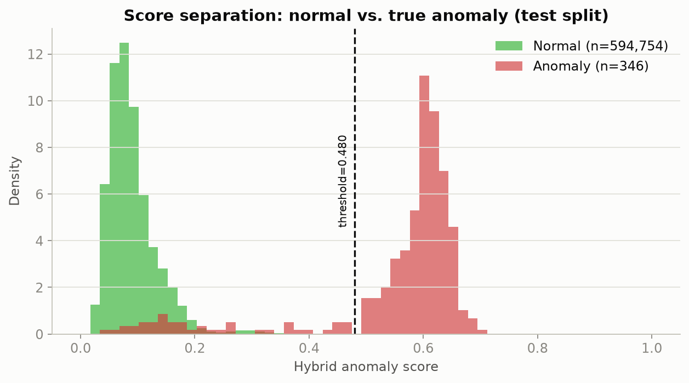
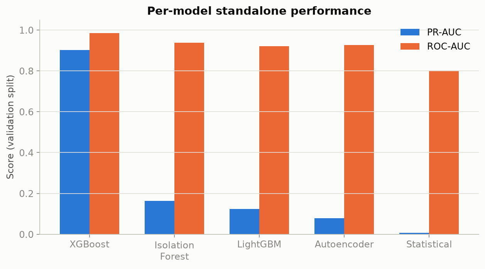
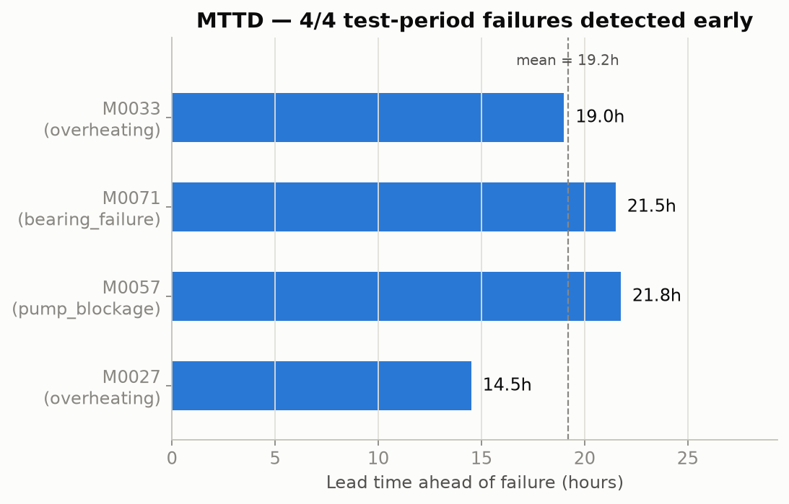
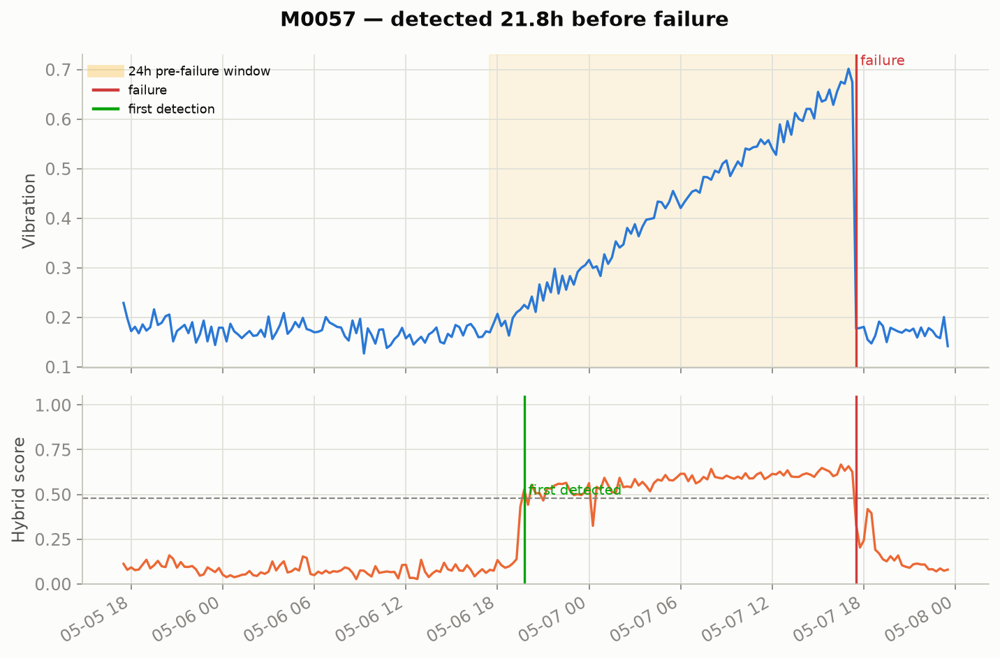

# Results

Real numbers and charts from training and evaluating the full hybrid
5-model system on the full-scale synthetic fleet (not the reduced config
used for fast local iteration). See [README.md](README.md) for
architecture, setup, and API documentation — this file is the evaluation
report: what the system actually achieves, how it was measured, and
where the measurement itself needed fixing along the way.

**Model version**: `20260824T174708Z` — reproducible via:

```bash
python -m src.data.generate_data
python -m src.models.train
python scripts/generate_report_charts.py   # regenerates every chart below
```

---

## 1. The dataset

500-machine fleet, 100 actively instrumented (temperature, pressure,
vibration, current, RPM, flow rate, power at 15-minute cadence), simulated
across 2026-01-01 → 2026-06-30 with injected point anomalies, sensor
drift, a stuck-sensor fault, a multivariate blockage signature, and 20
labeled failures with a 24-hour pre-failure degradation ramp.

| Split | Date range | Sensor readings | Failures |
|---|---|---|---|
| Train | 2026-01-01 → 2026-03-31 | 845,000 | 11 |
| Validation | 2026-04-01 → 2026-04-30 | 288,000 | 5 |
| Test | 2026-05-01 → 2026-06-30 | 595,100 | 4 |
| **Total** | 6 months | **1,737,600** | **20** |




---

## 2. Headline results

The hybrid score (weighted combination of all 5 models — see
[README.md § How scoring works](README.md#how-scoring-works)) at the
threshold selected by maximizing F1 on the validation split
(`threshold = 0.4797`):

| Split | PR-AUC | ROC-AUC | Precision | Recall | F1 |
|---|---|---|---|---|---|
| Validation | 0.883 | 0.974 | — | — | 0.920 |
| **Test** | **0.890** | **0.983** | **0.974** | **0.870** | **0.919** |



The hybrid score separates true anomalies from normal operation cleanly
— there's essentially no overlap between the two distributions at the
chosen threshold:



---

## 3. Per-model breakdown

Evaluated standalone (before combining into the hybrid score), on the
validation split:

| Model | Type | PR-AUC | ROC-AUC |
|---|---|---|---|
| **XGBoost** | supervised | **0.902** | **0.985** |
| Isolation Forest | unsupervised | 0.164 | 0.937 |
| LightGBM | supervised | 0.124 | 0.921 |
| Autoencoder | unsupervised | 0.078 | 0.926 |
| Statistical (z-score) | unsupervised | 0.006 | 0.802 |



**Reading this correctly matters.** XGBoost dominates because it's the
only model trained directly against the failure label (`scale_pos_weight
= 775.65`, reflecting how rare failures are in the training data) — it's
essentially learning "does this look like the lead-up to a failure we've
already seen," which is a much easier target than what the unsupervised
models are doing. Isolation Forest, the Autoencoder, and the statistical
score never see a failure label at all; they're each asking "does this
deviate from *this machine's own* normal operation," which is a harder,
noisier signal but the only one that can catch a failure mode the
training data never saw. The hybrid combines both: strong pattern-match
against known failure signatures, plus a safety net for genuinely novel
ones. **This is why the ensemble is worth keeping even though one member
dominates the leaderboard** — PR-AUC/ROC-AUC computed against the known
failure label structurally favors whichever model was trained on that
label; it doesn't measure the unsupervised models' actual job.

**One real finding worth a follow-up**: LightGBM (PR-AUC 0.124) trails
XGBoost (PR-AUC 0.902) by a wide margin despite training on identical
data and labels. Neither model's hyperparameters were tuned beyond the
values in `configs/config.yaml` — this gap is a hyperparameter-tuning
opportunity (or a candidate for dropping/reweighting LightGBM in the
ensemble), not evidence LightGBM can't do the job.

---

## 4. Business impact — Mean Time To Detection

The brief's actual ask: catch degradation *before* a failure, when
emergency repair (~£8,000) and downtime (~£15,000+) can still be
avoided by scheduling a planned intervention instead.

**Result: 4 of 4 test-period failures detected, with a mean lead time of
19.2 hours.**

| Machine | Failure type | Lead time |
|---|---|---|
| M0027 | overheating | 14.5h |
| M0033 | overheating | 19.0h |
| M0071 | bearing_failure | 21.5h |
| M0057 | pump_blockage | 21.8h |



Every detected failure gave at least half a working day of advance
notice — enough to schedule a planned maintenance window rather than
react to an unplanned stoppage.

### Case study: a bearing failure, hour by hour

`M0057`, a `pump_blockage` failure on 2026-05-07:



Vibration climbs steadily through the labeled 24-hour pre-failure window
(top panel). The hybrid score (bottom panel) crosses the alert threshold
almost as soon as that climb begins and stays elevated for the full
21.8-hour lead time — then drops sharply right after the failure, when
the pump's readings reset. This is the shape the whole system is built
to catch: not a single spike, but a sustained drift away from baseline.

---

## 5. Data & evaluation integrity fixes found during this run

Two real bugs surfaced by actually running the full pipeline at scale —
not visible from a code read — and both are now fixed in `src/`:

1. **Failure clustering (`src/data/generate_data.py`).** The original
   failure-timestamp sampling only drew from each machine's *last 1,000
   readings*, clustering every synthetic failure into the final ~10 days
   of the 6-month dataset — which fell entirely inside the test split.
   That left validation and training with **zero** positive examples:
   threshold selection was meaningless (validation F1 collapsed to 0),
   and the supervised models had nothing to learn from
   (`scale_pos_weight` silently defaulted to 1.0, the zero-positives
   fallback). Fixed to sample across each machine's entire time range.
2. **MTTD cross-period matching (`src/models/train.py`).**
   `calculate_mttd` joins alerts to failures by `machine_id` alone. Used
   directly against the full, all-time failures table, this let a
   machine's *unrelated* out-of-window failure record spuriously pair
   with a same-machine test-period alert, corrupting the lead-time
   calculation (an earlier run reported "4 of 5" detected from exactly
   this artifact). Fixed to filter to same-period failures before
   matching — confirmed against the trained model's real test-set scores
   post-hoc (no retraining needed, since the bug was in evaluation
   plumbing, not in the trained models themselves).

---

## 6. Limitations

- **Synthetic data.** Every number above is measured against simulated
  sensor data with a hand-coded degradation pattern, not a real fleet.
  The supervised models (XGBoost/LightGBM) are partly learning that
  specific synthetic ramp shape; real-world generalization to failure
  modes the training data has never seen is unproven and should be
  re-validated against real fleet data before trusting these numbers
  operationally.
- **Small failure count.** 20 failures total (11/5/4 per split) is a
  small sample for both training the supervised models and for
  statistical confidence in PR-AUC/ROC-AUC/MTTD — treat these as
  point estimates with real uncertainty, not fixed ground truth.
- **Single split, no cross-validation.** One random seed, one
  train/validation/test boundary. A different split could shift the
  selected threshold and the reported metrics measurably given how few
  failures there are per split.
- **Threshold is validation-specific.** `best_threshold_by_f1` optimizes
  against this one validation window's class balance; monitor and
  re-tune it as real operating conditions and failure rates diverge from
  this synthetic baseline (see [README.md § Monitoring & retraining](README.md#monitoring--retraining)).

## How these charts were made

Generated by [`scripts/generate_report_charts.py`](scripts/generate_report_charts.py)
directly from the trained artifacts in `models/` (no retraining) using
vectorized scoring — the same math as `src/models/train.py`, not the
per-row `AnomalyPredictor` streaming path, which is fine for one live
reading at a time but far too slow to bulk-score 595k historical rows.
Colors follow the `dataviz` skill's validated categorical/status
palette (fixed hue order, WCAG-checked contrast) rather than matplotlib
defaults.
